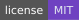
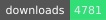
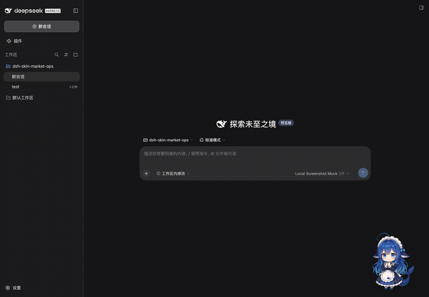
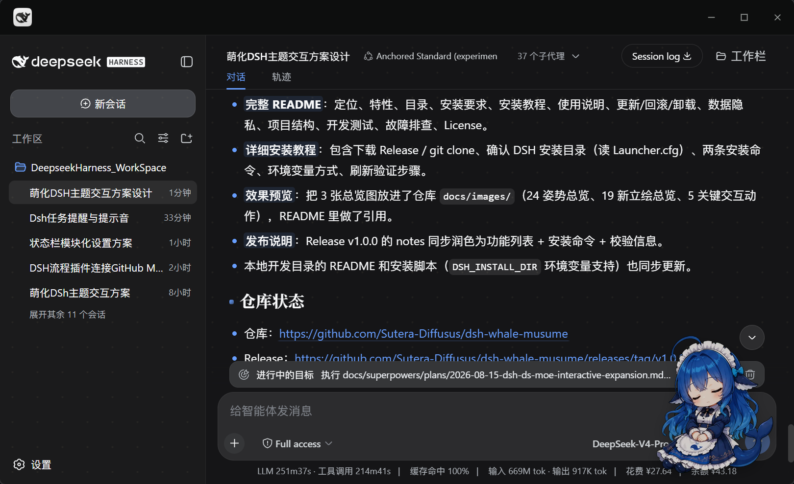
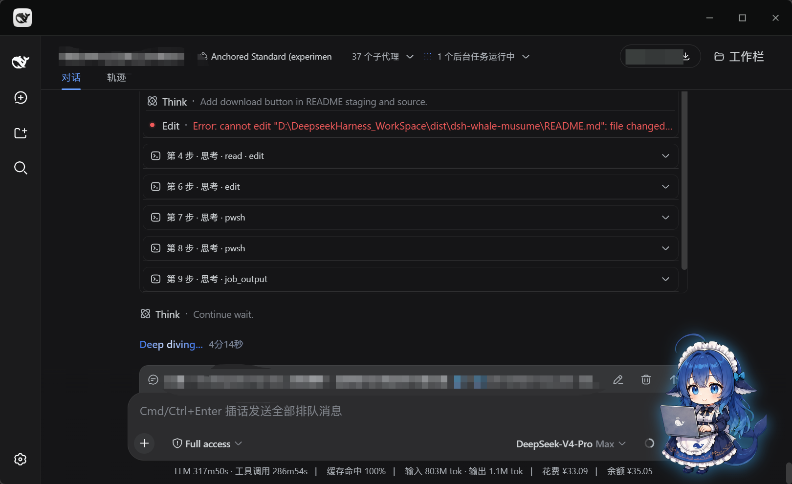
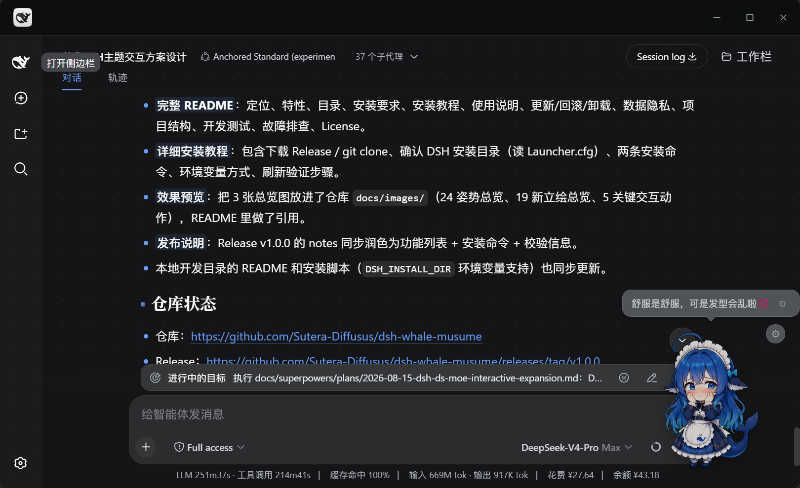
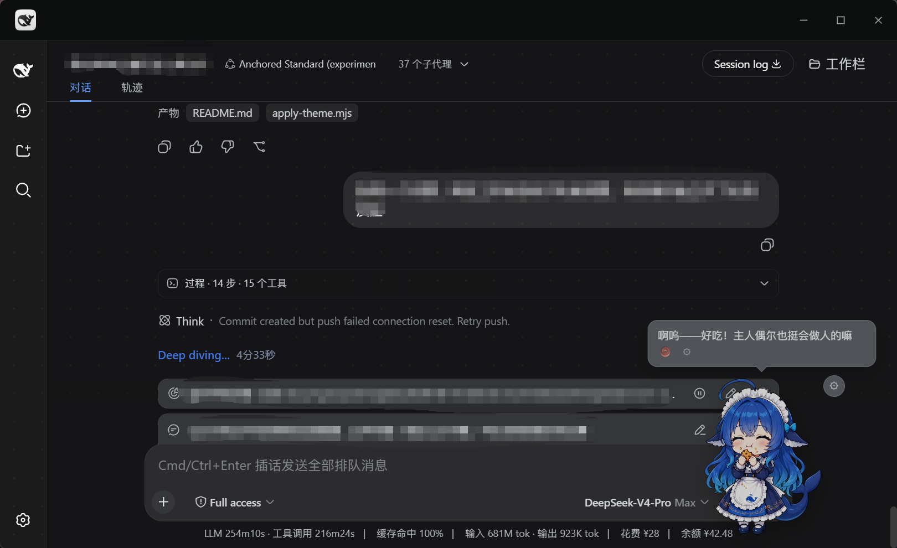
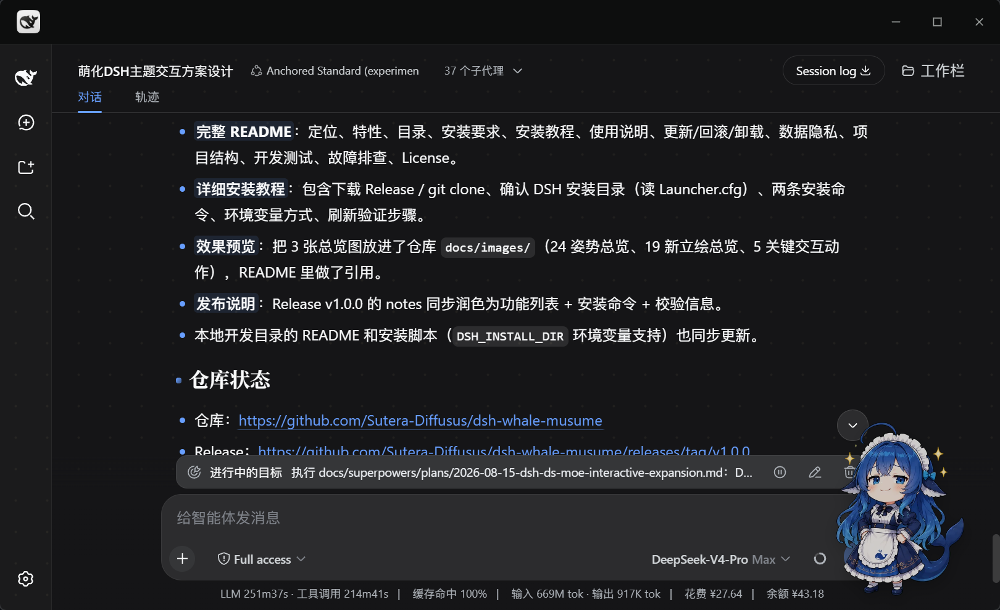
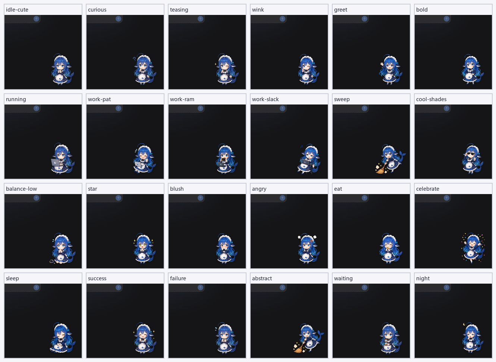

<div align="center">


# dsh-whale-musume · Whale Girl

**A desktop-pet mascot for DeepSeek Harness: quiet company while you code — the moment work starts, she picks up a laptop and stops talking.**

<a href="CHANGELOG.md"></a>
<a href=".github/workflows/test.yml"></a>
<a href="LICENSE"></a>
<a href="#compatibility"></a>
<a href="#compatibility"></a>
<a href="#compatibility"></a>
[](https://dshbase.com/zh/plugins/dsh-whale-musume/)
<a href="https://github.com/Sutera-Diffusus/dsh-whale-musume/releases"></a>
<a href="https://github.com/Sutera-Diffusus/dsh-whale-musume/discussions"></a>

[**Quick start**](#quick-start) · [**Screenshots**](#screenshots) · [**Features**](#features) · [**FAQ**](#faq) · [中文](README.md)



<sub>GIF recorded by [@kingOfSoySauce](https://github.com/kingOfSoySauce) ([PR #37](https://github.com/Sutera-Diffusus/dsh-whale-musume/pull/37)); vendored into the repo, no external hotlink.</sub>

</div>

---

## Why this one

Most desktop pets are either just an animated picture, or they steal your attention while you work. Three hard rules here:

| Principle | How it is implemented |
|---|---|
| **Never interrupt** | While tools are running the mascot **never speaks and never switches poses randomly**; all chatter, care prompts and announcements only happen when idle |
| **Never steal focus** | Decorative by default: `aria-hidden`, no keyboard capture, no writes to business DOM, no modifications to bundled packages. Even keyboard focus requires you to opt into accessibility mode |
| **No privacy tax** | No telemetry, no uploads, zero external requests by default. Everything that reads conversation content or account amounts (TTS playback, keyword reactions, balance, accessibility) is **off by default** |

And she actually knows what you are doing: instead of switching artwork on a timer, she reads the host's structural markers (tool-card state, session-running marker, terminal blocks) to decide which pose to hold and when to stay quiet.

---

## Table of Contents

- [Quick start](#quick-start)
- [Screenshots](#screenshots)
- [Who she is for](#who-she-is-for)
- [Features](#features)
- [Compatibility](#compatibility)
- [First run](#first-run)
- [Usage](#usage)
- [Settings panel](#settings-panel)
- [Update / Rollback / Uninstall](#update--rollback--uninstall)
- [Version History](#version-history)
- [Data & Privacy](#data--privacy)
- [FAQ](#faq)
- [Troubleshooting](#troubleshooting)
- [Roadmap](#roadmap)
- [Project Structure](#project-structure)
- [Development & Testing](#development--testing)
- [Contributing](#contributing)
- [Credits](#credits)
- [License](#license)

---

## Quick start

**Simplest: install from npm** (no `git ls-remote` preflight, more reliable on restricted networks):

```powershell
# DeepSeek Harness Desktop (Electron shell) — point the path at your install
$Desktop = "D:\DeepseekHarnessDesktop"
$Cli = "$Desktop\resources\app.asar\dsh\node_modules\@deepseek-ai\dsh-desktop-host\lib\cli.js"
$env:ELECTRON_RUN_AS_NODE = "1"
& "$Desktop\DeepSeek Harness.exe" --expose-internals $Cli plugin --profile desktop add dsh-whale-musume
```

```powershell
# Legacy web profile
dsh plugin --profile web add dsh-whale-musume
```

You can still install from the GitHub source (equivalent; use it to follow the latest `main` commits):

```powershell
dsh plugin --profile web add github:Sutera-Diffusus/dsh-whale-musume
```

Then **restart the host** (restart the desktop app, or restart `dsh web` and hit `Ctrl+F5`). She shows up in the bottom-right corner.

> **Mirror sync note**: on npmmirror a new package may briefly show `0.0.0-stage` (the publish placeholder). Do not install that version; switch the plugin manager's Registry selector to the **official npm registry**, or wait for the mirror to sync. Check the official source with `npm view dsh-whale-musume version --registry=https://registry.npmjs.org` — it should be `2.5.1`.

> If the plugin store or `dsh plugin add` fails to install it, see [When the plugin store cannot install it](#when-the-plugin-store--dsh-plugin-add-cannot-install-it). A log that only shows `[exit 1]`, `git ls-remote` timeouts on the git path, and the `allowBuilds` note are all covered there.

<details>
<summary>How do I verify the install actually worked?</summary>

Open the host's DevTools console (`F12`) and run:

```js
window.__dshWhaleMusumeBooted                                  // true
document.querySelectorAll('[data-dsh-whale-root]').length      // 1
getComputedStyle(document.querySelector('[data-dsh-whale-root]')).display  // "block" on the home view
window.__dshWhaleMoeDebug                                      // state is not "hidden"
```

If all four look right, you are done. Otherwise see [Troubleshooting](#troubleshooting).

</details>

> There is also a **script install** (injects frontend assets, ships its own backup/rollback) for theme-integration or legacy environments: see [`scripts/apply-theme.mjs`](scripts/apply-theme.mjs). Pick **one** method, do not mix them.

---

## Screenshots

<div align="center">

| Idle companion | Work-state integration |
|---|---|
|  |  |
| Floats bottom-right; random sips of coffee, stretches | Detects running tools, picks up a laptop with a soft blue glow |

| Head-pat reaction | Feeding |
|---|---|
|  |  |
| Click her head: blush artwork + hearts and stars | Right-click → feed: satiety and affection go up |

| Floating form (draggable) | Artwork overview (90+) |
|---|---|
|  |  |
| 200px by default; drag her wherever you like | States / interactions / growth / minigames / weather / festivals / meme faces |

</div>

More: [interaction board](docs/images/actions-board.png) · [new artwork board](docs/images/new-poses-board.png) · posters [v1](docs/images/promo-poster-v1.png) / [v2](docs/images/promo-poster-v2.png) / [v3](docs/images/promo-poster-v3.png) / [v4](docs/images/promo-poster-v4.png)

---

## Who she is for

- You want a companion with **progress to build**, not just an animated widget: daily quests, weekly check-ins, 45 achievements, three mini-games and a growth journal.
- You move between the **DSH desktop app and legacy web**, or between machines — she can export and import her save.
- You care about **local-first**: data stays in the host localStorage, no telemetry, clean uninstall; 203 tests cover the core logic and UI wiring.
- If you only want Live2D-grade animation or a standalone transparent desktop window, there are more specialised projects; the whale girl focuses on the companionship system.

---

## Features

### 🐋 Body & behaviour

| Feature | Detail |
|---|---|
| Five forms | Floating / side / bar / mini / auto; switches with the current view, 200px floating by default |
| Drag with inertia | Dragging switches to a "picked up" artwork that sways with the cursor; on release she slides a short distance and rotates upright, and grips the screen edge instead of spinning further. A gentle release only bounces once; the position is saved after the slide ends |
| Momentum-masked transitions | Idle ↔ work uses a "press down → swap artwork → pop up" transition with no ghosting and no black flash; a 1.6 s timeout covers browsers that pause image transitions in background tabs |
| Summon button | After you switch her off, a 🐋 button stays in the bottom-left corner so she can always be called back |

### 💼 Work-state integration

| Feature | Detail |
|---|---|
| Busy/idle reaction | Detects running tools and switches to "hugging a laptop", with a soft blue glow and a "working" label |
| Per-tool poses | Shell / file edits / search / tests / review / deploy / debug each map to a pose; anything unrecognised falls back to the generic working pose rather than guessing |
| Stable while working | No idle skits, no chatter during work; when a signal briefly disappears the pose holds (8 s on the workbench view, 4 s elsewhere) instead of twitching |
| Click reactions | While working, clicking her randomly shows "shy with laptop" or "snacking on a RAM stick" without interrupting the work state |

### 📈 Growth & achievements

- **Stats**: mood, affection, satiety, level, sign-in streak, companionship time
- **Daily quests**: three slots refreshed each day, each granting affection
- **Weekly sign-in**: seven-slot board with 1 / 3 / 7-day milestone rewards
- **Bond levels**: Lv3 unlocks a new idle action, Lv5 the title "Guardian of Whale Tide", Lv7 a hidden easter egg
- **45 achievements + achievement wall**: interaction / companionship / DSH usage / minigames / quests; unlocked ones highlighted, locked ones dimmed; new "Hundred-Day Pact", "One-Year Pact" and four memory-game achievements
- **Growth journal**: records bond level-ups and achievement unlocks, newest 12 shown first

### 💬 Dialogue & companionship

- **530+ lines** covering every scene, cute by default with safe meme flavours (office life, slacking off, deadlines, "drawing pies", unhinged-literature style lines)
- **13 meme keywords** (kyun, OMG, doge, sike, worship, peace, existential doubt, waku waku, …) turn her into the matching sticker face
- **Idle chatter every 5–8 minutes**, locally classified by what your current task looks like; never speaks during work, never greets between 23:00 and 05:59
- **Mood tiers**: gentle lines when mood is low, energetic ones when it is high; bond levels unlock their own lines
- **Weather companion**: leave the city empty for zero networking; otherwise uses Open-Meteo (free, no key) plus full-screen ambience (rain / snow / lightning / wind / fog / heat haze / frost), automatically toned down while working
- **Proactive care**: sitting reminder (25 min busily working) / late-night rest nudge / stuck-companion check (same state for 8 min) / welcome-back greeting (away over 3 min); at least 15 minutes between prompts
- **Two work-speech modes** (issue #24): thinking / tool / success / failure lines share one random cooldown window — **Chatty** 15–40 s, **Quiet** 90–240 s — so at most one line per window; thinking and tool lines are picked from the current task topic (same local classifier as idle chatter), while success / failure keep their own lines. Idle greetings and weather are unaffected; Chatty is the default
- **Optional TTS playback**: the "line playback" toggle only appears when the host provides a `dsh-xiaomi-tts` service; **off by default**, and a missing service, missing configuration or failed playback never affects normal interaction

### 🎀 Interactions & visuals

- **Zone clicks**: head / belly / tail are separate hit zones, each with its own artwork, effects and lines
- **Click effects**: hearts and stars fly out; three quick clicks trigger a starry-eyed celebration with particles and a spin
- **90+ artworks**: idle, working, thinking, away, four growth states, four minigame states, three weather states, five festival sets (Christmas / Halloween / Mid-Autumn / Lunar New Year / Valentine's, switched automatically on the day)
- **Three mini-games**: **Bubble Pop Party** (4×4 grid, normal / star / bomb, combo scoring, 30-second rounds), **Snack Catch** (catch falling snacks with keyboard or mouse, avoid bombs), and **Whale Memory** (4×4 memory match reusing 16 existing artworks; 60 seconds, combo bonus, zero-mistake clear); all three share the three reward-bearing rounds per day and are playable by mouse and keyboard

### 🧩 Engineering

- **Non-invasive**: pure frontend injection plus one read-only static asset route; no bundled package is modified
- **No build step**: the `assets/` directory in this repo *is* the runtime artifact
- **Artwork preloading**: the first screen loads only 5 common poses, the remaining 90+ are fetched one at a time every 120 ms while idle, so cold pose switches never stall; failures are silent
- **Accessibility mode** (off by default): Tab focus, Enter/Space to pat, arrow keys to nudge position (Shift to speed up), state changes announced through `aria-live`
- **Theme following**: follows the host's light/dark theme for bubbles and menus only — **artwork is never filtered**, so the art style is preserved
- **Testable**: the state machine and the presentation layer are separate; unit tests run with plain `node --test`

---

## Compatibility

| Host | Support | Notes |
|---|:---:|---|
| **DeepSeek Harness Desktop** `0.2.0-rc.2` | ✅ tested | That build's GUI defaulted to `127.0.0.1:19387`. Install and rollback: [0.2.0 deploy guide](docs/desktop-0.2.0-rc.2-deploy.md) |
| **DeepSeek Harness Desktop / Web** `0.2.1-rc.1`–`0.2.1-rc.5`, `0.2.2-rc.1` | ✅ static contract | Checked against upstream tags, a DOM-marker scan of the local `0.2.2-rc.1` `app.asar`, and the unit tests. **Not** re-run visually inside Electron. Desktop 0.2.1 binds with `--port 0` (OS-assigned); do not assume `19387`. See the [0.2.1 contract](docs/desktop-0.2.1-rc.2-contract.md), [deploy delta](docs/desktop-0.2.1-rc.2-deploy.md) and the [v2.5.1 notes](docs/release-notes-v2.5.1.md) |
| `0.2.2-alpha.2`, `0.2.2-alpha.3` | ⚠️ installable, not certified | Allowed by `engines.dsh` (part of the 0.2.2 line) but not verified per release; marked `unknown` in the matrix |
| **Legacy web profile** (DSH `0.1.x`) | ✅ tested | `0.1.0-rc.6` and newer; the settings panel is verified on `0.1.1-rc.2` |
| Other profiles (headless / acp, …) | ➖ no UI | There is no browser surface, so there is nowhere to show a pet |

| Requirement | Value |
|---|---|
| OS | Windows 10 / 11 (the current desktop app's support range) |
| Node.js | 18+ (script install only; the bundle install needs nothing) |
| Browser | Recent Edge / Chrome |

> **Data does not carry over**: the desktop app's window origin is `dsh-app://app` while the legacy web UI is `http://127.0.0.1:<port>`. Their `localStorage` (`whale-moe:*`) is separate and is not migrated automatically. See [Data & Privacy](#data--privacy).

<details>
<summary>Which DSH 0.2.0-rc.2 contracts had to change? (for plugin authors)</summary>

When porting to the desktop app we audited every contract against the real `0.2.0-rc.2` runtime, with file:line evidence in [`docs/desktop-0.2.0-rc.2-contract.md`](docs/desktop-0.2.0-rc.2-contract.md):

| Contract | Change in 0.2.0-rc.2 | What we do now |
|---|---|---|
| Tool cards | `[data-role="tool"]` and friends match nothing | Use `[data-tool]` (value = tool name) + same-element `data-state` |
| Busy detection | Finished tool cards **stay in the DOM** (`ok`/`stopped`) | Only `running` / `preparing` count as "working" |
| Session running | New `[data-chat-running]` (mounted only while running) | Used as the cleanest live signal |
| Terminal | `[data-slot="terminal"]` no longer exists | Use `[data-terminal]` |
| Composer | Now contenteditable | Use `[data-composer-input]` |
| Theme | Written to `body[data-ds-dark-theme]` (**empty string = dark**) | Recognised; legacy `data-theme`/class kept as fallback |
| Settings panel | The always-present onboarding modal is also `role="dialog"` | Detection narrowed to `[data-shortcut-modal="settings"]` |
| Client modules | Lazy CJS: side effects belong to factory materialization | `boot()` moved from `apply()` into the factory |
| Onboarding modal | Present on every fresh load | No longer mistaken for the settings page (which used to hide the mascot) |

All of these have regression assertions in `test/desktop-client.test.mjs` (34 of them).

v2.4.0 re-checked tag `dsh-v0.2.1-rc.2` ([`docs/desktop-0.2.1-rc.2-contract.md`](docs/desktop-0.2.1-rc.2-contract.md)). Those markers are still there, so no selector changed. The install gate did: since DSH `0.2.1-alpha.4`, top-level `engines.dsh` wins. This package declares `>=0.1.0-rc.6 <0.2.0-rc.1 || 0.2.0-rc.2 || 0.2.1-rc.1 || 0.2.1-rc.2`. Marking `0.2.1-rc.1` / `0.2.1-rc.2` compatible means that static check plus unit tests, not a live desktop run.

</details>

---

## First run

Seven things worth trying in the first minute:

1. **Click her once** — blush artwork and a heart effect;
2. **Click three times quickly** — starry-eyed celebration, particles, spin;
3. **Drag her around** — "picked up" artwork, swaying with the cursor, then a short slide and a saved position;
4. **Right-click her** — feed / poke / praise / three mini-games / back to home / open settings;
5. **Run a tool call** — she picks up the laptop with a soft blue glow;
6. **Open Settings → Mascot** — 15 toggles plus the work-speech two-mode switch, growth stats, achievement wall and growth journal live there;
7. **Before switching machines** — Settings → Mascot → Cross-device migration: export a save or copy a migration code.

---

## Usage

### Dragging

- Hold and move; the position is saved on release. Dragging only starts after 4px of movement, so a single click never turns into a drag
- Right-click → **back to home** restores the default bottom-right position

### Right-click menu

| Item | Effect |
|---|---|
| Feed a snack | Satiety and affection up, eating artwork |
| Poke | Mood down, angry artwork |
| Praise her | Mood and affection up, starry eyes |
| Minigame: bubble pop | Opens the 30-second bubble party |
| Minigame: snack catch | Catch snacks with keyboard or mouse, avoid bombs |
| Minigame: whale memory | 4×4 memory match, 60 seconds, combo and zero-mistake bonuses |
| Back to home | Clears the saved floating position |
| Open settings | Jumps to DSH Settings → Mascot |

---

## Settings panel

Path: **DSH Settings → Mascot** — 15 pill toggles, a Chatty / Quiet work-speech switch, and eight collapsible groups.

| Group | Contents |
|---|---|
| Companion behaviour | What to call you, **her self-name** (empty falls back to the default), mascot on/off, speech bubbles, work speech (Chatty / Quiet), TTS playback (optional), particles, keyword reactions, slacking reminders, night mode, per-tool poses, drag inertia, proactive care, accessibility |
| Weather | City, optional API key, weather effects toggle |
| Balance | Balance care toggle, show-number toggle, current balance and tier |
| Daily & growth | Today's quests / weekly sign-in / titles (tabbed) |
| Achievement wall | 45 achievements, unlocked highlighted, locked dimmed |
| Growth journal | Bond level-ups and achievement unlocks, newest 12 first |
| Cross-device migration | Export / import a save (JSON), or copy / paste a migration code; carries affection, level, achievements, quests, game records and journal |
| Data & reset | Reset floating position, reset growth data |

**Off by default** (these read conversation content or account amounts): keyword reactions, balance care, show-balance-number, TTS playback, accessibility.

### Cross-device migration (desktop ↔ legacy web)

Growth data lives in the host origin's `localStorage`, so it does not follow you to the desktop app, another machine or another profile. Entry: **Settings → Mascot → Cross-device migration**.

- **Export save**: downloads a JSON file containing mood / affection / satiety / level / sign-in / achievements / quests / game records / growth journal / names. It **excludes** the floating position, weather city and coordinates.
- **Copy migration code**: carries the core progress only (stats / achievements / journal / names) — handy for pasting into a chat window.
- **Import**: pick the JSON file or paste a `WM1-…` code, confirm, and same-named data is overwritten; the mascot reloads immediately without a page refresh.
- The code has a checksum: a truncated copy fails with a clear error and **never touches your existing save**.

---

## Update / Rollback / Uninstall

### Update

```powershell
# Desktop app (then restart the app)
& "$Desktop\DeepSeek Harness.exe" --expose-internals $Cli plugin --profile desktop add github:Sutera-Diffusus/dsh-whale-musume

# Legacy web (then restart dsh web and Ctrl+F5)
dsh plugin --profile web add github:Sutera-Diffusus/dsh-whale-musume
```

Updating never touches your growth data (`whale-moe:*` stays in the host origin's `localStorage`).

### Uninstall

```powershell
# Desktop app
& "$Desktop\DeepSeek Harness.exe" --expose-internals $Cli plugin --profile desktop remove dsh-whale-musume

# Legacy web
dsh plugin --profile web remove dsh-whale-musume
```

The bundle install rewrites **no files at all**, so uninstalling removes it cleanly; growth data stays and is still there if you reinstall. To just hide her temporarily, switch off "Mascot" in the settings panel.

### Script install

The script writes a backup into `DSH_WHALE_BACKUP` (system temp by default); roll back with:

```powershell
node scripts/apply-theme.mjs --rollback "<backup dir>"
```

---

## Version History

| Version | Date | Theme | Highlights | Links |
|---|---|---|---|---|
| **v2.5.1** | 2026-11-06 | DSH 0.2.1-rc.3–0.2.2-rc.1 support + invisible-mascot fix | See highlights below | [Release](https://github.com/Sutera-Diffusus/dsh-whale-musume/releases/tag/v2.5.1) · [Notes](docs/release-notes-v2.5.1.md) |
| **v2.5.0** | 2026-10-21 | Memory game + migration | Third mini-game "Whale Memory" (16 existing artworks, 60 s, combo / zero-mistake); new "Cross-device migration" settings group (JSON export/import + migration code, hot reload); six new achievements (four memory + hundred-day / one-year), 45 total | [Release](https://github.com/Sutera-Diffusus/dsh-whale-musume/releases/tag/v2.5.0) · [Notes](docs/release-notes-v2.5.0.md) |
| **v2.4.0** | 2026-10-19 | DSH 0.2.1-rc.2 support | Declares `engines.dsh`; `0.2.1-rc.1` / `0.2.1-rc.2` marked compatible from a static contract (not a live Electron run); `0.2.0-rc.2` and legacy Web stay allowed; no selector changes | [Release](https://github.com/Sutera-Diffusus/dsh-whale-musume/releases/tag/v2.4.0) · [Notes](docs/release-notes-v2.4.0.md) |
| **v2.3.0** | 2026-10-14 | Two work-speech modes + menu placement fix | See highlights below | [Release](https://github.com/Sutera-Diffusus/dsh-whale-musume/releases/tag/v2.3.0) · [Notes](docs/release-notes-v2.3.0.md) |
| **v2.2.1** | 2026-10-01 | Popups stay on screen at screen edges | See highlights below | [Release](https://github.com/Sutera-Diffusus/dsh-whale-musume/releases/tag/v2.2.1) · [Notes](docs/release-notes-v2.2.1.md) |
| **v2.2.0** | 2026-09-29 | DeepSeek Harness Desktop support | Desktop (Electron shell, bundled DSH `0.2.0-rc.2`): lazy-CJS boot timing, DOM contract (`[data-tool]` / `[data-chat-running]` / `[data-terminal]` / contenteditable composer), theme attribute (`body[data-ds-dark-theme]`), settings-panel detection; fixes a false "working" state on first paint | [Release](https://github.com/Sutera-Diffusus/dsh-whale-musume/releases/tag/v2.2.0) · [Notes](docs/release-notes-v2.2.0.md) |
| v2.1.0 | 2026-09-14 | She talks, and no longer vanishes | Optional MiMo TTS line playback; fix for the mascot disappearing behind dialogs (now a bottom-right mini); fix for settings-panel registration timing; prefer CNY balance account; GitHub Actions CI | [Release](https://github.com/Sutera-Diffusus/dsh-whale-musume/releases/tag/v2.1.0) |
| v2.0.1 | 2026-09-05 | Store compatibility declaration | `dsh.compatibility.dshReleases` matrix; restored lineage to the store's pinned commit | [CHANGELOG](CHANGELOG.md) |
| v2.0.0 | 2026-08-28 | Balance · Tools · Journal | Balance readout, artwork preloading, per-tool poses, drag inertia, proactive care, accessibility mode, growth journal, theme adaptation | [Release](https://github.com/Sutera-Diffusus/dsh-whale-musume/releases/tag/v2.0.0) |
| v1.5.0 | 2026-08-28 | Custom self-name + summon button | Custom mascot self-name; a 🐋 summon button appears when she is switched off | [Release](https://github.com/Sutera-Diffusus/dsh-whale-musume/releases/tag/v1.5.0) |
| v1.4.2 | 2026-08-28 | DSH 0.1.1-rc.2 support | Fix for a stuck "flipped over" artwork after errors; fix for an unresponsive settings entry; settings panel shipped with the bundle | [Release](https://github.com/Sutera-Diffusus/dsh-whale-musume/releases/tag/v1.4.2) |

- Full per-release changes: [CHANGELOG.md](CHANGELOG.md)
- All releases: [Releases](https://github.com/Sutera-Diffusus/dsh-whale-musume/releases) (a few versions ship as CHANGELOG entries only, e.g. v2.0.1)

---

## Data & Privacy

| Item | Fact |
|---|---|
| Storage | The host window's `localStorage`, keys prefixed `whale-moe:` (desktop origin is `dsh-app://app`) |
| Cross-host migration | **Manual, local-only**: Settings → Mascot → Cross-device migration exports a JSON save or a `WM1-…` code (core progress). Nothing is uploaded; you move the file or string yourself |
| Telemetry | **None.** No uploads, no analytics |
| External requests | **Zero by default.** Weather only after you enter a city (Open-Meteo, free, no key); an empty city means no networking at all |
| Balance feature | **Off by default.** When enabled it only talks to the **local** balance proxy `127.0.0.1:3020` (the upstream call happens on the proxy side); with "show number" off, the UI only shows tier wording so screenshots never leak amounts |
| Credentials | No API keys are bundled; an optional weather key stays in local `localStorage` |
| Host impact | Pure frontend injection: no bundled package and no business DOM is modified; uninstalling removes it cleanly |

---

## FAQ

<details>
<summary><b>She is not visible after a refresh — what is the most likely cause?</b></summary>

1. Check the plugin is enabled: you should see a "Mascot" section in settings, and `window.__dshWhaleMusumeBooted === true`;
2. Check the "Mascot" toggle is on (Settings → Mascot → companion behaviour);
3. If the settings panel is open — she is hidden **by design** there (a decoration should not cover the UI); close it and she is back;
4. On the desktop app you **must restart the app** after installing; refreshing the page is not always enough.
</details>

<details>
<summary><b>My desktop data is empty — where did my affection and achievements go?</b></summary>

Expected: the desktop origin is `dsh-app://app`, which is not the same storage domain as the legacy web UI's `http://127.0.0.1:<port>`, so `whale-moe:*` does not carry over automatically. Since v2.5.0 you can migrate it yourself: **Settings → Mascot → Cross-device migration** — export a save on the old host, then import it on the new one (or copy/paste the `WM1-…` code).
</details>

<details>
<summary><b>Does she read my chat content?</b></summary>

Not by default. Only if **you** turn on "keyword reactions" does she match 13 meme keywords locally to switch into a sticker face — matching happens inside the browser and nothing is sent out. The balance features work the same way and are off by default.
</details>

<details>
<summary><b>Will she get in the way of copying code or clicking buttons?</b></summary>

She occupies a small corner and only ever touches her own nodes: no keyboard capture, no writes to business DOM, no edits to bundled files. She is `aria-hidden` by default, so screen readers are not disturbed. Drag her anywhere you like.
</details>

<details>
<summary><b>Can I swap in another character, or use her as a theme?</b></summary>

This repo is "character + presentation layer" and does not provide theme packaging (since v1.1.5 `apply` no longer registers a theme option). For a different character, reuse this project's structure in your own fork: the state machine (`assets/whale-moe-core.js`) is separate from the presentation layer (`assets/dsh-whale-moe.js`), so replacing the latter is enough.
</details>

<details>
<summary><b>What is left behind after uninstalling?</b></summary>

The bundle install leaves no files behind (no bundled package edits, no config writes); only your growth data stays in `localStorage`. To wipe that too, use Settings → Mascot → Data & reset, or clear the site data for that origin.
</details>

---

## Troubleshooting

| Symptom | Fix |
|---|---|
| Not visible after a refresh | Confirm the install command succeeded and the plugin is enabled; hard-refresh (`Ctrl+F5`); check the "Mascot" toggle |
| No "Mascot" section in settings | Check that your DSH version matches the install method; if the `slots` service is unavailable the panel is skipped but the mascot itself still works (look for `[dsh-whale-musume]` warnings in the console) |
| Desktop app shows no change | **Restart the desktop app** (not just a page refresh) |
| Artwork not updating / misaligned | Hard-refresh; asset URLs are versioned, so clear site cache if it is stale |
| Switched her off and cannot find her | A 🐋 summon button sits in the bottom-left corner |
| Drag triggers accidentally | Dragging needs 4px of movement; a click alone never starts one |
| Want the default position back | Right-click → back to home |
| No TTS sound | "Line playback" needs `dsh-xiaomi-tts` installed in the host and the toggle switched on; the toggle is hidden otherwise |
| Mixed both install methods | Fully uninstall/roll back one method first, then reinstall with the other |

### When the plugin store / `dsh plugin add` cannot install it

Short version: this is a **pure front-end plugin bundle** — no `prepare` script, zero `dependencies`, and the build output is committed to the repo, so **installing needs no build step at all**. Failures therefore come from the two external conditions of the git install path: **can you reach GitHub**, and **can your profile's registry resolve the market package**. Neither is a defect in this plugin. Also note the plugin is **not published to npm**, so the store will always fail to find it and fall back to a git install — that is expected behaviour, not a fault.

| Key line in the log | What it means | What to do |
|---|---|---|
| `git ls-remote ... failed` / `failedAt: 'spec-host'` | your machine cannot reach GitHub | pre-check below |
| `ERR_PNPM_NO_MATCHING_VERSION` / `404 ... not found` | registry mirror has not synced that version yet | switch to the official registry and retry; mirrors usually catch up within hours |
| `Ignored build scripts: <pkg>` | pnpm blocked a build script (never happens for this plugin) | only then touch `allowBuilds` |
| `[exit 1]` with no key line | truncated log | attach `<DSH Home>\profiles\<profile>\hub.log` and `.plugin-manager\logs\operation-*\pnpm.log` to an issue |

```powershell
# no output within 10s = GitHub is unreachable or too slow from this machine
git -c credential.helper= ls-remote -- https://github.com/Sutera-Diffusus/dsh-whale-musume.git HEAD

# behind a proxy (use your own port)
git config --global http.https://github.com.proxy http://127.0.0.1:7890
```

DSH runs that `git ls-remote` as a connectivity pre-check with a **5-second default timeout** (`githubConnectionTimeoutMs`), so a slow link fails the whole install before pnpm even starts. The `allowBuilds` hint DSH appends on git-form failures only checks whether the install argument looks like a git URL — **it does not check whether the package needs building**, so for this plugin it is a false positive: never edit `pnpm-workspace.yaml` unless pnpm itself printed `Ignored build scripts: <pkg>`.

**Most reliable route — bypass git and the registry:** download `dsh-whale-musume-plugin-v<version>.zip` plus `SHA256SUMS-v<version>.txt` from [Releases](https://github.com/Sutera-Diffusus/dsh-whale-musume/releases), unpack it, and install by local path (`$Desktop` / `$Cli` as defined in the [desktop deploy doc](docs/desktop-0.2.0-rc.2-deploy.md)):

```powershell
$env:ELECTRON_RUN_AS_NODE = "1"
& "$Desktop\DeepSeek Harness.exe" --expose-internals $Cli plugin --profile desktop add "<unpacked path>\dsh-whale-musume"

# legacy web
dsh plugin --profile web add "<unpacked path>\dsh-whale-musume"
```

Then **restart the desktop app** (a page refresh is not enough). Sanity checks: `window.__dshWhaleMusumeBooted === true` and `document.querySelectorAll('[data-dsh-whale-root]').length === 1`. `add` does not overwrite an installed version, so `remove` + `add` is the reliable way to move to a newer build; your growth data (`whale-moe:*`) lives in the host origin's `localStorage` and survives reinstalls.

---

## Roadmap

No dates promised, but the direction is clear. Vote or add ideas in [Discussions](https://github.com/Sutera-Diffusus/dsh-whale-musume/discussions) or [Issues](https://github.com/Sutera-Diffusus/dsh-whale-musume/issues).

- **Incremental merge for exported saves**: import currently overwrites same-named data; a "top up progress, never downgrade" merge mode is planned
- **Desktop acceptance scripts**: `npm run qa` still assumes the legacy web host and needs a desktop-oriented version
- **English docs parity**: bring the docs up to the same level as the Chinese ones
- **Optional character packs**: extract a presentation-layer interface so other people can swap in their own character

**Known limitations** (boundaries, not backlog):

- The desktop app is verified on Windows 10 / 11 only; macOS / Linux desktop builds are unverified
- npm package published: `dsh plugin add dsh-whale-musume`; installing from the GitHub source remains available (`dsh plugin add github:Sutera-Diffusus/dsh-whale-musume`)
- `npm run qa` / `qa:soak` target the legacy web host; use `tools/cdp-verify-whale.mjs` and `tools/cdp-contract-whale.mjs` for the desktop app

---

## Project Structure

```text
dsh-whale-musume/
├─ assets/                          # runtime artifact (the repo *is* the artifact, no build step)
│  ├─ dsh-whale-moe.css             # mascot styles and animations
│  ├─ dsh-whale-moe.js              # DOM presentation layer, state scheduling, interactions
│  ├─ whale-moe-core.js             # pure-function state machine (unit-testable)
│  ├─ peek-calibration.json         # peek artwork calibration
│  └─ generated/                    # 92 artworks (states/interactions/growth/minigames/weather/festivals/memes)
├─ lib/
│  ├─ index.js                      # host plugin: read-only asset route /api/dsh-whale-musume/assets
│  └─ client.js                     # client plugin: injects style/state machine/presentation + settings panel
├─ scripts/
│  ├─ apply-theme.mjs               # script install / rollback / settings injection
│  ├─ gen-assets.py                 # artwork generation pipeline (third-party image API, key via env)
│  ├─ build-assets.py               # artwork asset build
│  ├─ build-review.py               # artwork review page
│  └─ slice-batch.py                # poster slicing
├─ test/
│  ├─ *.test.mjs                    # unit and contract tests
│  ├─ desktop-client.test.mjs       # desktop (0.2.0-rc.2) contract and regression assertions
│  ├─ dsh-engines.test.mjs          # engines.dsh range and the 0.2.1 matrix
│  ├─ cdp-whale-moe.mjs             # full CDP acceptance for the legacy web host
│  ├─ motion-qa.mjs / soak-work.mjs # motion quality and 60s soak
│  └─ showcase-*.mjs                # artwork/action board generators
├─ tools/
│  ├─ dom-stub.mjs                  # browser-free DOM stub (contract assertion base)
│  ├─ cdp-verify-whale.mjs          # one-shot headless verification
│  ├─ cdp-contract-whale.mjs        # one-shot headless contract checks
│  └─ asar.mjs                      # read-only asar tool (desktop recon)
├─ docs/
│  ├─ desktop-0.2.0-rc.2-contract.md    # 0.2.0-rc.2 contract audit (live)
│  ├─ desktop-0.2.0-rc.2-deploy.md      # desktop deploy/rollback/uninstall guide
│  ├─ desktop-0.2.0-rc.2-acceptance.md  # 0.2.0-rc.2 acceptance report
│  ├─ desktop-0.2.1-rc.2-contract.md    # 0.2.1-rc.2 contract delta (static, no Electron run)
│  ├─ desktop-0.2.1-rc.2-deploy.md      # 0.2.1 deploy delta against the 0.2.0 guide
│  ├─ release-notes-v2.5.0.md           # v2.5.0 release notes
│  ├─ release-notes-v2.4.0.md           # v2.4.0 release notes
│  └─ images/                       # logo, screenshots, artwork boards
├─ .github/
│  ├─ workflows/test.yml            # CI: npm test on Node 18 / 22
│  ├─ release.yml                   # release-note categorisation rules
│  └─ ISSUE_TEMPLATE/               # issue and PR templates
├─ LICENSE · README.md · README.en.md · CHANGELOG.md · SECURITY.md · CONTRIBUTING.md
└─ CODE_OF_CONDUCT.md
```

---

## Development & Testing

```powershell
# unit and contract tests (no browser or server needed)
npm test

# equivalent explicit form
node --test test/*test.mjs

# motion quality check (needs a legacy-web test copy on port 3181)
node test/motion-qa.mjs

# full CDP acceptance for the legacy web host (needs a copy + Edge/Chrome CDP on 9223)
node test/cdp-whale-moe.mjs
```

Conventions live in [CONTRIBUTING.md](CONTRIBUTING.md): after touching the presentation layer in `assets/`, run `npm test`; for desktop selector/signal changes, cross-check [`docs/desktop-0.2.0-rc.2-contract.md`](docs/desktop-0.2.0-rc.2-contract.md) and [`docs/desktop-0.2.1-rc.2-contract.md`](docs/desktop-0.2.1-rc.2-contract.md).

---

## Contributing

- 🐛 **Found a bug** → [open an issue](https://github.com/Sutera-Diffusus/dsh-whale-musume/issues/new/choose) (templates ask for version and repro steps)
- 💡 **Feature ideas** → [Discussions](https://github.com/Sutera-Diffusus/dsh-whale-musume/discussions)
- 🔧 **Send a PR** → read [CONTRIBUTING.md](CONTRIBUTING.md) first; one commit per concern, `fix:` / `feat:` / `chore:` prefixes
- 🔒 **Security issues** → do not open a public issue, see [SECURITY.md](SECURITY.md)
- 🤝 **Code of conduct** → participating in discussions or PRs means you agree to [CODE_OF_CONDUCT.md](CODE_OF_CONDUCT.md)
- ⭐ **If she is useful** → a star is the most concrete support and helps other DSH users find her

---

## Credits

- **[@SuteraWu](https://github.com/SuteraWu)** — project author; most of the artwork and the presentation layer
- **[@ppy-web](https://github.com/ppy-web)** — MiMo TTS line playback integration (v2.1.0)
- **[@icemaple77](https://github.com/icemaple77)** — fix for the mascot vanishing behind dialogs, and CNY-preferred balance accounts (v2.1.0)
- **[@Lurantis](https://github.com/Lurantis)** — early contributions
- **[@ClutchBear](https://github.com/ClutchBear)** — unofficial native Windows port, [workbuddy-whale-musume](https://github.com/ClutchBear/workbuddy-whale-musume) (Rust; no affiliation with this project, and not an official Windows build). MIT attribution was confirmed in [#17](https://github.com/Sutera-Diffusus/dsh-whale-musume/issues/17)
- **[@kingOfSoySauce](https://github.com/kingOfSoySauce)** — the idle-loop GIF used in this README ([PR #37](https://github.com/Sutera-Diffusus/dsh-whale-musume/pull/37), vendored in v2.5.1)
- Thanks also to [DeepSeek Harness](https://github.com/deepseek-ai/deepseek-harness) for the plugin system, and to the directories that list and test community plugins: [awesome-deepseek-harness](https://github.com/0xsline/awesome-deepseek-harness), [awesome-dsh-plugins](https://github.com/kejixiaoliang/awesome-dsh-plugins), [WhaleHub](https://github.com/vvlife/whalehub-dsh), [dshbase](https://dshbase.com/zh/plugins/dsh-whale-musume/), [dsh-meme-hub](https://github.com/the-beating-light-of-the-nail/dsh-meme-hub)

## License

[MIT](LICENSE) © Sutera-Diffusus

<div align="center">

**She codes with you, and slacks off with you.** 🐳

[Back to top](#dsh-whale-musume--whale-girl) · [Latest release](https://github.com/Sutera-Diffusus/dsh-whale-musume/releases/latest) · [中文](README.md)

</div>
